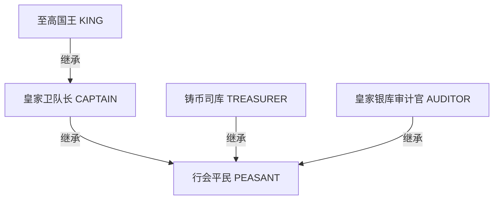
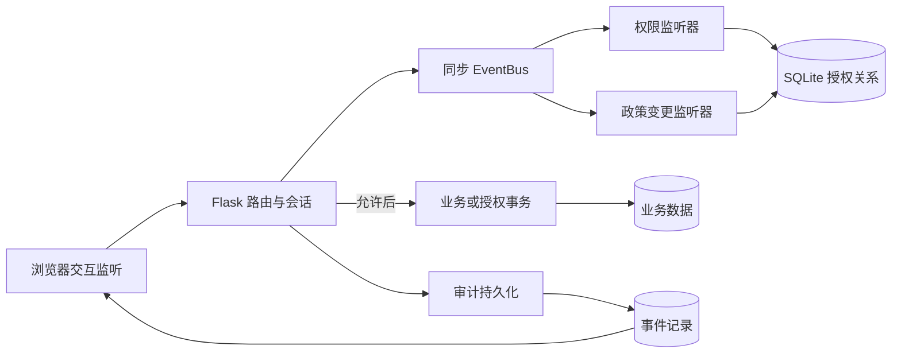
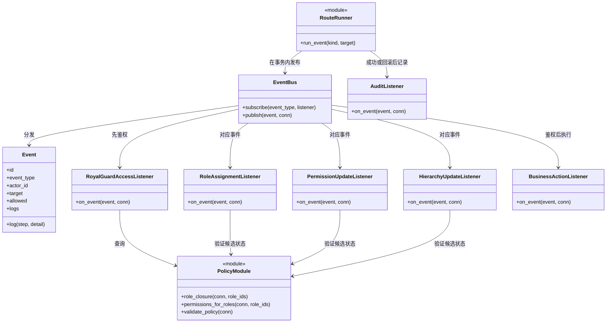
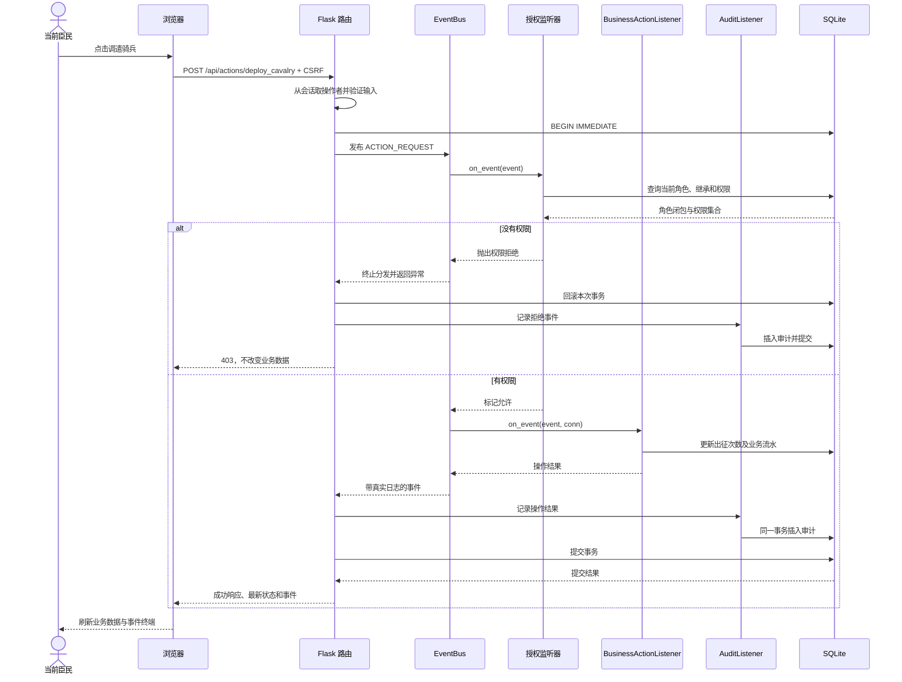
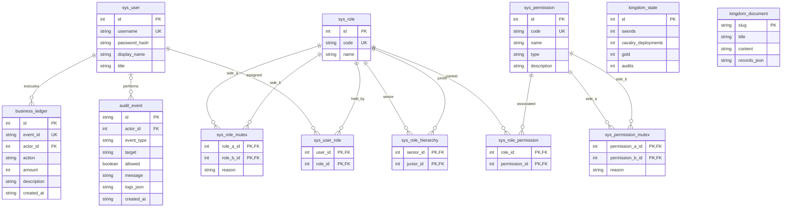

# 库滕贝格皇家铸币厂与市政厅：分析与设计

人物、三处领地和格罗申记账的来源及教学边界见[场景说明](kuttenberg-scenario.md)。本次主题改造保持角色与权限码、API及四项实际业务数值，只迁移已发布的默认展示名称；独立`theme_meta`版本保留定制标签、原授权、策略版本与历史流水。

## 1. 作业目标与范围

本项目用本地 Flask + SQLite 应用，展示基于角色的访问控制（RBAC）如何参与事件处理。用户是王国臣民，角色是官职，权限是访问领地菜单、读取卷轴页面、执行政令及管理授权的资格。题目中的“基于权限的用户访问控制”在此采用 RBAC 的标准含义：基于角色的访问控制。

| 作业要求 | 对应设计与可检查证据 |
| --- | --- |
| 完整代码实现 | Flask 应用、RBAC 引擎、同步事件总线、数据库初始化、原生前端和自动化测试；运行方式见 README |
| 页面操作显示，角色与权限控制 | 五个演示账号；领地菜单、真实卷轴路由、四种持久化政令；角色分配及权限矩阵管理 |
| 基于监听器模式及事件响应 | 浏览器事件监听 → HTTP 请求 → EventBus → 授权/约束监听器 → 响应和审计；事件终端展示实际处理步骤 |
| 分析页面、菜单、按钮控制异同 | 第 5 节比较三种资源及各自服务端边界，演示绕过隐藏菜单和按钮后的直接请求 |
| 所有权限保存在数据库表中 | 权限目录、角色—权限、用户—角色、继承边及 SSD 约束均持久化；重启不重置 |
| RBAC 模型族扩展比较 | RBAC0 会话及角色分配、RBAC1 继承闭包、RBAC2 静态职责分离、二者组合；额外业务约束另行说明 |

这是单机教学应用，默认只绑定本机地址。公开教学账号便于课堂切换身份，不能作为生产系统的账号策略。本项目不宣称完整实现某一 RBAC 标准，也不包含动态职责分离（DSD）、完整 ARBAC、跨系统单点登录、对象所有权授权、不可篡改日志或多节点部署。

## 2. 方案选择与原型修正

采用 Python 3、Flask、SQLite、HTML/CSS 和原生 JavaScript。SQLite 避免另装数据库服务器；本地静态资源避免课堂网络不稳定影响界面；前后端拆分便于检查鉴权究竟发生在哪一侧。

原始提案的主题、资源分类和事件终端予以保留，并作以下修正：

1. 操作者从签名会话取得，不信任业务请求中的 `user_id`。
2. 授权管理按接口能力及委派边界检查，普通臣民无法自助册封；部分管理员也不能自授其他管理能力。
3. 卷轴有真实受控 URL，政令会改变数据库，不只返回“成功”文字。
4. 初始化只创建缺失表和首次种子，重启不会删除现有数据。
5. SSD 检查继承后的角色闭包，层级编辑也检查受影响用户。
6. 国王不自动拥有全部权限，财政与审计保持职责边界。
7. 额外检查财政与审计权限冲突，避免绕过互斥角色而直接授予两种敏感权限。
8. 界面终端使用真实事件结果，审计持久化到 SQLite。


## 3. 参与者、场景与授权矩阵

| 用户名 | 展示身份 | 初始直接角色 | 主要演示用途 |
| --- | --- | --- | --- |
| `henry` | 亨利，铁匠学徒 | 行会平民 | 最小业务权限、军事越权拒绝 |
| `radzig` | 拉德季·科比拉 | 皇家卫队长 | 军事权限和对平民角色的继承 |
| `hans` | 汉斯 | 铸币司库 | 读取国库、拨款；不具有独立审计权 |
| `wenceslas` | 瓦茨拉夫四世 | 至高国王 | 军事继承、权限管理、全体审计记录；不默认拨款或审计账本 |
| `agnes` | 阿格尼丝 | 皇家银库审计官 | 读取国库并审计；不能拨款 |

所有演示账号的公开教学密码为 `Kingdom@2026`。密码以摘要保存，登录后服务端会话识别当前用户。登录身份与给用户分配的官职是两个不同概念；改变显示头衔不会改变授权。

下表是种子状态下的**有效权限**，包含继承；`✓` 表示获得权限，`—` 表示未获得。权限矩阵编辑的是直接权限，因此应与继承后的有效权限区分。

| 权限码 | 类型 | 平民 | 卫队长 | 铸币司库 | 国王 | 审计官 |
| --- | --- | --- | --- | --- | --- | --- |
| `menu:square` | MENU | ✓ | ✓ | ✓ | ✓ | ✓ |
| `menu:armory` | MENU | — | ✓ | — | ✓ | — |
| `menu:treasury` | MENU | — | — | ✓ | ✓ | ✓ |
| `page:tax_scroll` | PAGE | ✓ | ✓ | ✓ | ✓ | ✓ |
| `page:defense_map` | PAGE | — | ✓ | — | ✓ | — |
| `page:royal_ledger` | PAGE | — | — | ✓ | ✓ | ✓ |
| `btn:forge_sword` | BUTTON | ✓ | ✓ | ✓ | ✓ | ✓ |
| `btn:deploy_cavalry` | BUTTON | — | ✓ | — | ✓ | — |
| `btn:open_vault` | BUTTON | — | — | ✓ | — | — |
| `btn:audit_ledger` | BUTTON | — | — | — | — | ✓ |
| `admin:assign` | ADMIN | — | — | — | ✓ | — |
| `admin:policy` | ADMIN | — | — | — | ✓ | — |
| `admin:audit` | ADMIN | — | — | — | ✓ | — |

国王能读取国库总账不代表能拨款，具有系统审计查看权也不等于具有业务账本审计权。`admin:audit` 允许查看全体授权事件；`btn:audit_ledger` 执行一次财政业务审计。这是两个独立资源。

政令的可观察结果：铸剑使铁剑数增加 1，调遣骑兵使出征次数增加 1，拨款使国库格罗申减少 100；独立审计读取格罗申流水、核对实际余额并保存报告，使审计次数增加 1。只有授权通过、业务前置条件成立并成功提交事务时才发生变化；国库余额不足等业务失败不等同于权限不足。

## 4. RBAC 模型与形式化规则

令用户集合为 `U`，角色集合为 `R`，权限集合为 `P`，会话集合为 `S`。用户—角色关系 `UA ⊆ U×R`，角色—权限关系 `PA ⊆ R×P`。会话 `s` 关联唯一用户 `user(s)`，并保存激活角色集合 `A(s)`。

### 4.1 RBAC0：关联与会话

用户直接获分配的角色为：

```text
D(u) = { r ∈ R | (u,r) ∈ UA }
A(s) ⊆ D(user(s))
```

登录默认激活全部当前直接角色，用户可通过 `/api/session/roles` 激活其中一个子集，也可以全部停用。激活不授予新角色。管理员新增分配的角色需要目标用户自行激活或重新登录，不自动增加旧会话的激活集合。每次请求都重新结合数据库当前分配关系计算，撤销角色或权限后，旧会话不能继续沿用已撤销授权。

会话保存在 Flask 签名 Cookie 中，它不等于数据库中新增一种业务角色；RBAC 的会话是逻辑主体，无须强行对应一张关系表。角色临时停用也不等于撤销分配。

### 4.2 RBAC1：角色层级

继承边 `H ⊆ R×R` 中 `(senior,junior)` 表示高级角色继承低级角色的权限。本项目使用多继承 DAG，求闭包时去重，并拒绝自环、循环及不存在的角色。

```text
C(X) = X ∪ { 从 X 出发沿继承边能够到达的全部角色 }
E(s) = C(A(s) ∩ D(user(s)))
P(s) = { p | 存在 r ∈ E(s)，且 (r,p) ∈ PA }
permit(s,p) ⇔ p 存在于权限目录中 且 p ∈ P(s)
```

初始层级：



国王未被直接分配平民和卫队长角色，也能通过继承获得铸剑、军事菜单和调遣权限。财政与审计分支没有被国王默认继承。

### 4.3 RBAC2：静态职责分离

数据库保存互斥对 `M`。本项目只实现其中的 SSD 约束：同一用户的**已授权角色闭包**不能同时包含铸币司库和审计官。

```text
对每个用户 u、每个互斥对 (a,b) ∈ M：
    不允许 {a,b} ⊆ C(D(u))
```

SSD 检查分配关系，不随会话临时停用角色而解除。用户不能同时获授两种互斥职责，再通过“当前只激活一个”规避 SSD。后者属于另外一种可设计的 DSD 策略，本项目没有把它混称为已实现能力。

实现还对每个角色定义本身的继承闭包作同样检查，包括尚未分配给用户的角色。这一角色定义卫生约束比只检查用户更严格；不允许先创建一个同时继承财政和审计的角色，留待以后分配。

### 4.4 RBAC3：层级与约束同时成立

RBAC3 是层级与约束的组合，不能只分别运行两段互不关联的代码。分配角色、替换继承边或修改权限时，在同一事务中检验候选状态；继承间接产生冲突与直接分配冲突同样拒绝。[RBAC 模型族原文](https://csrc.nist.gov/csrc/media/projects/role-based-access-control/documents/sandhu96.pdf)

### 4.5 额外业务策略

角色互斥本身不能阻止管理员把两种敏感操作直接授给一个其他角色。为保持本例“管钱与查账分开”的业务语义，另加以下策略：

```text
任意角色的继承后权限集合，以及任意用户的已授权权限集合：
    不得同时包含 btn:open_vault 与 btn:audit_ledger
```

这是本系统的业务权限冲突约束，不声称是所有 RBAC 系统的必备规则。授权修改还须保证至少一个用户的已授权权限同时包含 `admin:assign`、`admin:policy` 和 `admin:audit`，以免保存不可管理的政策。会话中临时停用管理角色不会删除该用户的授权，因此可以自行重新激活。

### 4.6 管理委派与版本

管理权限的接口检查只是第一步。当前激活全部三项管理权限的用户是明确受信任的完整管理员，可向其他用户委派符合全局约束的业务角色，无须自己先执行该业务。部分册封者只能委派修改前有效权限覆盖的非管理角色；部分策略管理员不能通过矩阵或继承引入自己原来没有的业务能力。业务范围检查针对新增能力，部分policy仍可撤销其他角色的业务授权，未实现按管理对象划分管辖权。改变任何角色或用户的管理能力需要完整管理员；直接管理授权和通向管理角色的继承边变更也要求完整管理员，即使当下只构成冗余路径。所有用户都不能修改自己的直接角色分配。这是有限委派规则，不等于完整ARBAC或双人审批。

三类政策修改还必须提交读入快照的`base_revision`。事务中核对版本，不匹配返回409 `STALE_POLICY`；成功递增版本并记录实际变更。原子替换保证“不留下半份配置”，版本检查保证“不以旧表单覆盖新配置”，两者解决的问题不同。前端不静默重放过期候选。

## 5. 菜单、页面、按钮控制的异同

| 维度 | MENU 菜单 | PAGE 页面 | BUTTON 功能按钮 |
| --- | --- | --- | --- |
| 被控制对象 | 模块导航入口 | 一个视图及其数据 | 一项具体业务命令 |
| 本例 | 军械与行会 | 边疆布防图 | 调遣骑兵 |
| 界面处理 | 根据有效权限隐藏或锁定入口 | 允许后加载卷轴内容；拒绝则展示拒绝状态 | 根据权限启用操作；可使用独立越权探测发出测试请求 |
| 服务端入口 | `/api/navigation/armory` | `/api/pages/defense_map` 与 `/pages/defense_map` | `POST /api/actions/deploy_cavalry` |
| 成功结果 | 导航响应 | 返回真实页面或正文数据 | 数据库业务状态发生变化 |
| 主要绕行风险 | 手工显示被隐藏入口 | 地址栏直接输入 URL | 使用控制台或 HTTP 客户端直接请求接口 |

三者的共同点是以数据库权限码建模，经过同一有效角色计算、同步授权事件与服务端裁决。隐藏菜单和禁用按钮是界面反馈，服务端鉴权才是最终边界。

三类权限互相独立：有菜单不自动拥有页面，有页面不自动拥有操作。给平民只增加 `btn:deploy_cavalry` 后，他可以执行该命令，但不会因此获得军事菜单或布防图。若产品需要“动作必须同时具有页面权限”，应明确增加合取规则；本项目使用独立权限，便于说明三者差异。

资源目录与领地归属也保存到SQLite。普通领地视图按归属渲染页面与动作，初始选择第一个有权限的菜单；没有菜单则显示空状态。另设跨域实验区，用清楚的领域标记演示“有动作权限但没有菜单权限”，而不把军事动作无解释地放在公共广场。页面深链接通过hash记录视图位置，恢复后仍从服务端读取受保护数据。

未知权限、未知受控资源、没有激活角色以及未被明确允许的请求都不会得到默认放行。服务端先鉴权再读取受控正文，拒绝响应不包含卷轴正文和记录。大厅的四个业务汇总计数向已登录用户公开，属于教学仪表盘；受控的布防正文和国库业务流水不包含在通用状态 JSON 中。

## 6. 架构与事件机制



浏览器使用原生事件监听接收点击、提交和角色激活等动作；服务器的监听器模式解决“收到什么请求，由谁判断和响应”。授权事件必须同步处理，调用方等待裁决，不能先执行操作再异步检查。

下面的类名对应 `rbac/events.py`。策略计算是 `rbac/policy.py` 中的函数模块，图中以模块形式表示。`AuditListener` 由 `rbac/routes.py` 的 `run_event` 在事务边界直接调用，**没有注册为总线中的最后一个监听器**，以便成功和异常路径都使用一致审计逻辑。



典型政令流程：



同一事件关联编号贯穿日志与响应。`EVENT_EMIT`、`LISTENER_CAPTURED`、`ROLE_CLOSURE`、`DECISION_ALLOW` / `DECISION_DENY` 等步骤来自实际执行；最终返回的 `DB_COMMIT` 和 `AUDIT_PERSIST` 表示相应阶段已经完成。授权先通过、后续业务却失败的事件可以同时出现阶段性 `DECISION_ALLOW` 与最终 `DECISION_DENY`，应以事件最终 `allowed` 和 HTTP 状态为准。终端不是预先编排的动画，也不捏造 SQL 语句。

## 7. 数据库逻辑设计

数据库保留授权实体、卷轴正文、业务状态和审计事件。以下 ER 图使用实际物理表名；会话由 Flask 管理，不在图中伪造会话关系表。`schema_meta` 保存初始化版本，属于技术元数据，未在关系图中展开。



权限表包含 MENU、PAGE、BUTTON、ADMIN 四类数据库记录。前三类对应题目资源粒度，ADMIN 用于保护授权管理本身。关联表采用联合主键避免重复，外键避免孤儿引用，`CHECK` 约束限制非法类型和结构；SQLite 连接显式启用外键检查。

HTTP 路由中的权限码表示“这个接口要求什么权限”，它不是用户授权名单。谁拥有权限由数据库关联决定；不能把某个用户的特权写死在 `if username == ...` 中。角色继承、SSD 对和敏感权限冲突对都从数据库读取，分别位于 `sys_role_hierarchy`、`sys_role_mutex` 和 `sys_permission_mutex`。

`kingdom_state` 保存单行教学指标，`kingdom_document` 保存三种卷轴正文及初始记录；`business_ledger` 保存每次真实政令的事件编号、操作者、变化量和时间。`schema_meta` 中的版本标记与初始种子在同一事务提交，以免重启重复播种。`business_ledger.event_id` 是唯一业务关联编号，实际 schema 未将它声明为 `audit_event` 外键；两者的一致写入由成功事务保证。

审计保存事件阶段、目标、操作者与裁决原因。普通账号只能读自己的事件，拥有 `admin:audit` 才可查看全体事件。审计用于课堂追溯，不具有抵抗数据库文件所有者篡改的能力。

版本2在上述核心表之外增加`ui_resource`（资源展示目录与领地归属）、`policy_state`（策略版本）、`accounting_baseline`（固定开账余额）和`audit_report`（可追溯余额核对结果）。v1升级使用增量建表与版本标志，不重播既有UA/PA、继承、状态、流水或审计；开账余额沿用原教学模型3200枚，不由升级时的当前余额反推。启动完成前验证外键与全局政策，非法数据拒绝正常启动；不自动修复或静默丢弃异常授权。

## 8. 安全边界、事务与失败处理

### 8.1 身份与请求边界

公开的账号目录不包含密码摘要或受控正文。登录验证密码并建立签名会话，业务路由从会话确定操作者。`/api/admin/users/<id>/roles` 中的 ID 是被管理对象，不是当前操作者。

所有 POST / PUT 请求验证 `X-CSRF-Token`。服务端每次重新计算当前权限，不依赖浏览器缓存的权限列表；Cookie 签名不能代替资源鉴权。前端用安全文本插入展示服务器数据，避免角色名或事件详情被当作脚本。

这些选择落实默认拒绝、逐请求鉴权和可信边界内检查的原则。[OWASP 授权建议](https://cheatsheetseries.owasp.org/cheatsheets/Authorization_Cheat_Sheet.html) · [OWASP CSRF 建议](https://cheatsheetseries.owasp.org/cheatsheets/Cross-Site_Request_Forgery_Prevention_Cheat_Sheet.html)

### 8.2 政策变更事务

角色分配、直接权限替换、继承边整体替换都先检查调用者的管理权限、修改前的委派范围和快照版本，再在事务中的候选状态上检查数据引用、无环性、角色/用户 SSD、业务权限冲突及剩余管理员。任何一项失败则整体回滚，避免先删旧配置、再插新配置失败造成部分授权。完整管理员也不能修改自己的直接角色分配。

检查须覆盖所有受影响角色和用户，不只修改对象当前的激活会话。政策保存之后，其他会话下一次请求就根据新状态计算，因而撤权不等待重新登录。

### 8.3 业务与审计

`run_event` 使用 `BEGIN IMMEDIATE`，将授权查询、成功业务/政策修改和成功审计放在同一事务中。即使是受控页面的只读检查也会写审计；提前取得写事务可避免政策修改插入到鉴权与执行之间，但它是单机低并发取舍，不适合作为高吞吐架构。

GET附带访问日志符合[HTTP安全方法的定义](https://www.rfc-editor.org/rfc/rfc9110.html#section-9.2.1)，不应与通过GET执行拨款混为一谈。当前代价是受控读请求也竞争写锁。WAL不能让多名写者并行；本次没有在缺少负载证据时更换事务或同步级别。

独立审计从开账余额与已记录格罗申收支计算预期余额，再与`kingdom_state.gold`核对；铸剑及出征的计数不参与金额求和。保存报告包含实际/预期余额、差异、流水数量与覆盖上界；报告、审计计数、业务流水及成功事件一起提交。差异不为0应显示核对异常。此功能没有外部凭证，不能发现账本与余额被共同篡改，也不提供真实财务鉴证。

鉴权未通过时不执行业务写入；监听器、业务或成功审计发生异常时，先整体回滚。随后以独立事务保存拒绝/失败审计。若成功审计不可写，本次业务也不会生效；若拒绝审计再次失败，返回 `503 AUDIT_FAILURE`，事件中用 `AUDIT_FAILURE` 标明失败，不显示虚假的保存完成步骤。其他未预期的事件错误返回 `503 EVENT_FAILURE`。余额不足等可预期业务冲突保留独立原因和 409 状态。

CSRF 或 JSON 等在事件发布前被拒绝的请求使用统一错误响应，不会自动生成一条授权事件；事件终端不是对每一个 HTTP 请求的完整网络日志。运行期间应保留数据库文件的可写权限和足够空间。本系统不提供跨数据库分布式原子性或抵抗本地磁盘损坏的保证。

### 8.4 响应语义

| HTTP 状态 | 含义 | 示例 |
| --- | --- | --- |
| 200 | 请求完成 | 读取允许页面、执行允许政令、保存合法政策 |
| 400 | 参数格式不合法 | 错误 JSON、非法 ID 类型或列表结构 |
| 401 | 尚未建立有效登录会话 | 未登录读取受控资源 |
| 403 | 当前会话无权限或 CSRF 不通过 | 平民请求调遣骑兵 |
| 404 | 资源或目标实体不存在 | 不存在的卷轴路径、用户或角色 |
| 409 | 候选状态、版本或业务状态发生冲突 | SSD、继承环、权限冲突、STALE_POLICY |
| 503 | 事件处理或审计存储失败，业务回滚 | 数据库写入异常、审计触发器拒绝插入 |

## 9. 验证与要求映射

| 验证项 | 自动化检查重点 | 演示指南对应 |
| --- | --- | --- |
| 身份可信 | 未登录请求、错误密码、伪造调用者参数、CSRF 缺失 | 第 1、2 步 |
| 三级控制 | 菜单 API、真实 HTML/JSON 页面、动作 API 各自鉴权；拒绝无正文和副作用 | 第 1、2、3 步 |
| 正常业务 | 四种操作按预期改变计数或余额 | 第 2 步及扩展项 |
| RBAC1 | 国王经闭包获得卫队长和平民权限，国王无默认财政审计权 | 第 3 步 |
| 会话角色 | 空激活集、非法激活、恢复激活、撤权后旧会话 | 第 4 步 |
| SSD 与 RBAC3 | 直接互斥、间接继承冲突、继承环均回滚 | 第 5 步 |
| 业务权限约束 | 直接向一角色同时授予拨款和审计被拒绝 | 第 5 步扩展项 |
| 动态政策 | 修改权限后现有会话下一次请求使用新状态，最后管理者保护 | 第 6 步 |
| 数据库持久化 | 重新创建应用连接同一数据库后授权和业务数据保持 | 第 7 步 |
| 审计 | 成功/拒绝可追溯，普通账号不能读取其他用户事件 | 全程事件终端 |
| 故障与并发 | 注入审计失败验证整体回滚；两个拨款请求竞争最后 100 格罗申时只允许一个成功 | 自动化补充 |

实际测试文件映射：`tests/test_authorization.py` 检查登录、CSRF、伪造身份、受控路由、三级独立权限和激活角色；`tests/test_policy.py` 检查 SSD、继承环/菱形继承、额外权限互斥、管理员保留及旧会话撤权；`tests/test_business_and_persistence.py` 检查业务副作用、事件范围、外键和重启；`tests/test_engine_and_failures.py` 检查无监听器默认拒绝、非法输入、审计故障回滚与并发拨款。

自动化测试结果见项目测试输出及验收记录。测试只证明已覆盖场景在当前环境通过，不把测试数量当作完整安全性证明。课堂验收应同时观察界面、真实 HTTP 状态、数据库副作用和重启后的数据。

## 10. 资料与实现边界

模型术语参考 [Sandhu 等：Role-Based Access Control Models](https://csrc.nist.gov/csrc/media/projects/role-based-access-control/documents/sandhu96.pdf)；角色层级性质可参阅 [NIST IR 6192](https://csrc.nist.gov/Pubs/ir/6192/Final)。安全设计参考 [OWASP Authorization Cheat Sheet](https://cheatsheetseries.owasp.org/cheatsheets/Authorization_Cheat_Sheet.html)。

本项目用少量业务资源展示角色、会话、继承、SSD 和事件响应之间的关系。把菜单、页面、按钮归类为权限是工程建模选择；RBAC 不规定必须使用这三类，也不会自动解决所有数据级、流程级和组织治理问题。
